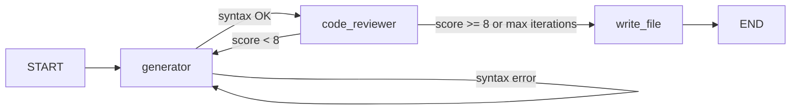

# Code Generator

A small **LangGraph** workflow that turns a natural-language problem into Python code using a local (or cloud-backed) **Ollama** model. The pipeline generates code, checks Python syntax, optionally refines it based on an LLM code review, and writes the result to `generated_code.py`.

## What it does

1. **Generator** — Uses `ChatOllama` with prompts from `src/code_generator/config/prompts.yaml` to produce Python from your problem statement (and to fix syntax errors or apply review feedback on later passes).
2. **Syntax checker** — Parses the code with Python’s `ast` module. On `SyntaxError`, it loops back to the generator with error details.
3. **Code reviewer** — Scores the solution (1–10) and returns structured feedback. Scores below 8 trigger a refactor loop, up to `max_itr` (default 5 in the CLI).
4. **Write file** — Saves the final code to `generated_code.py` in the directory where you run the command.



### Project layout

| Path | Purpose |
|------|---------|
| `src/code_generator/main.py` | CLI entry (`--prompt` / `-p`) |
| `src/code_generator/core/graph.py` | LangGraph workflow definition |
| `src/code_generator/config/config.yaml` | Ollama **model name** and **temperature** |
| `src/code_generator/config/prompts.yaml` | System and user prompts for generator and reviewer |
| `pyproject.toml` / `uv.lock` | Dependencies and lockfile (managed with **uv**) |

---

## Run the project with uv (any computer)

This repo uses **[uv](https://docs.astral.sh/uv/)** for Python version management, virtual environments, and installs. You do not need to create a venv manually or run `pip install` by hand.

### 1. Install uv

Pick the method that matches your OS.

**Windows (PowerShell):**

```powershell
powershell -ExecutionPolicy ByPass -c "irm https://astral.sh/uv/install.ps1 | iex"
```

**macOS / Linux:**

```bash
curl -LsSf https://astral.sh/uv/install.sh | sh
```

Restart your terminal, then confirm:

```bash
uv --version
```

### 2. Get the code

```bash
git clone git@github.com:Nileshtn/code-generator-langgraph.git
cd code-generator-langgraph
```

(Or unzip/copy the project folder if you are not using git.)

### 3. Install dependencies

From the project root (where `pyproject.toml` lives):

```bash
uv sync
```

This will:

- Use Python **3.11+** (see `.python-version` and `requires-python` in `pyproject.toml`).
- Create a project virtual environment (typically `.venv` in the project root).
- Install locked dependencies from `uv.lock`.

### 4. Run the CLI

Pass a problem description with `-p` / `--prompt`:

```bash
uv run code-generator -p "Write a function that returns the nth Fibonacci number"
```

Equivalent:

```bash
uv run python -m code_generator.main -p "Write a function that returns the nth Fibonacci number"
```

After a successful run, open **`generated_code.py`** in the same directory.

### 5. Useful uv commands

| Command | When to use it |
|---------|----------------|
| `uv sync` | First setup, or after pulling changes to `pyproject.toml` / `uv.lock` |
| `uv run <command>` | Run the app or any tool inside the project environment without activating the venv |
| `uv add <package>` | Add a new dependency (updates `pyproject.toml` and lockfile) |
| `uv lock` | Refresh the lockfile after editing `pyproject.toml` manually |

**Tip:** On a machine without Python installed, uv can still install the right interpreter when you run `uv sync` (uv downloads Python as needed).

---

## Install Ollama and use `gemma4:31b-cloud`

The app talks to Ollama’s HTTP API (default `http://localhost:11434`) via **langchain-ollama**. Ollama must be installed and the model you configure must be available to that Ollama instance.

### 1. Install Ollama

1. Download the installer from [https://ollama.com/download](https://ollama.com/download).
2. Install and start Ollama (on Windows it usually runs as a background app after install).
3. Verify the CLI:

```bash
ollama --version
```

### 2. Pull and run `gemma4:31b-cloud`

The default model in this project is set in `src/code_generator/config/config.yaml`:

```yaml
model : "gemma4:31b-cloud"
temp : 0.1
```

Download the model (name must match `config.yaml` exactly):

```bash
ollama pull gemma4:31b-cloud
```

Smoke-test that Ollama serves it:

```bash
ollama run gemma4:31b-cloud "Say hello in one sentence."
```

Leave Ollama running while you use `uv run code-generator ...`.

**Cloud-tagged models:** Names ending in `-cloud` are served through Ollama’s cloud offering where supported. You may need to sign in to Ollama and meet any account or network requirements described in [Ollama’s documentation](https://github.com/ollama/ollama). If `pull` or `run` fails, check the Ollama app logs and their model library for the exact tag.

### 3. Remote Ollama (optional)

If Ollama runs on another host or port, set:

```bash
# Linux / macOS
export OLLAMA_HOST=http://your-host:11434

# Windows PowerShell
$env:OLLAMA_HOST = "http://your-host:11434"
```

Then run `uv run code-generator` as usual.

---

## Switch to another Ollama model

All generator and reviewer nodes read the same settings from **`src/code_generator/config/config.yaml`**.

### Step 1 — Choose a model

List models you already have:

```bash
ollama list
```

Browse available models on [https://ollama.com/library](https://ollama.com/library), then pull one:

```bash
ollama pull llama3.2
# or
ollama pull qwen2.5-coder:7b
```

Use the **exact** name shown by `ollama list` or the library (including tags like `:7b`).

### Step 2 — Update config

Edit `src/code_generator/config/config.yaml`:

```yaml
model : "llama3.2"        # example — use your model name
temp : 0.1                # optional: raise slightly for more variety
```

Save the file. No code changes are required unless you add new config keys.

### Step 3 — Run again

```bash
uv run code-generator -p "Your problem here"
```

### Notes when changing models

- **VRAM / RAM:** Larger models need more memory. If generation is slow or Ollama errors with OOM, try a smaller tag (e.g. `:7b` instead of `:70b`).
- **Structured review output:** The code reviewer uses `with_structured_output(CodeReviewResult)`. Most recent chat models work well; if review fails with a new model, try another model or check Ollama logs.
- **Temperature:** `temp` in `config.yaml` is shared by generator and reviewer. Lower values (e.g. `0.1`) tend to be more deterministic for code.

---

## Configuration reference

| Setting | File | Description |
|---------|------|-------------|
| `model` | `config.yaml` | Ollama model name passed to `ChatOllama` |
| `temp` | `config.yaml` | Sampling temperature for both LLM nodes |
| Prompts | `prompts.yaml` | Generator and quality-review instructions |

---

## Requirements summary

- **Python** 3.11+
- **uv** for environment and dependencies
- **Ollama** running with the model named in `config.yaml`
- Enough disk space for the chosen model weights (cloud models may reduce local disk use depending on Ollama’s behavior)

---

## License and author

See `pyproject.toml` for package metadata. For issues with generation quality, tune prompts in `prompts.yaml` or try a different Ollama model in `config.yaml`.
